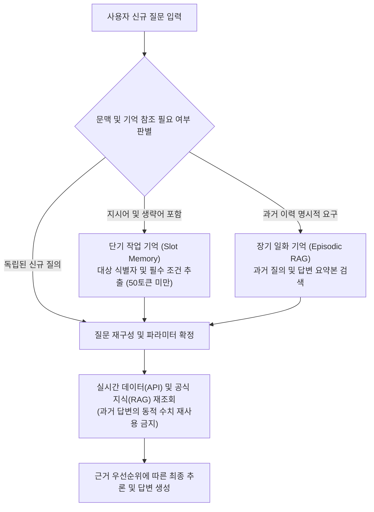

import { ArticleLayout } from '@/components/ArticleLayout'

export const article = {
  author: 'kkennib',
  date: '2026-10-21',
  title: '기억 기반 개인화 추론 아키텍처',
  description:
    'AI 에이전트가 과거의 대화를 기억하고 사용자 맞춤형 추론을 수행할 때 마주하는 구조적 한계와, 과거의 기억이 현재의 사실을 왜곡하지 않도록 통제하는 계층적 메모리 및 근거 우선순위 설계.',
}

export const metadata = {
  title: article.title,
  description: article.description,
}

export default (props) => <ArticleLayout article={article} {...props} />

## 기억 기반 개인화 추론 아키텍처

대화형 인공지능과 자율 에이전트를 실무에 도입할 때 사용자가 가장 먼저 마주하는 불편함은 단발성(Stateless: 이전 대화 내용을 보존하지 않고 각 질의를 독립적인 사건으로 처리하는 방식) 상호작용이다. 방금 전까지 논의하던 분석 맥락을 다음 질문에서 온전히 잊어버리거나, 이전에 전달했던 작업 조건과 선호 서식을 매번 새로 입력해야 할 때 사용자는 에이전트를 협업 파트너가 아닌 단순한 문장 자동 완성기로 인식하게 된다. 이러한 한계를 극복하고 자연스러운 대화 흐름을 형성하기 위해 도입된 메커니즘이 바로 <strong>기억 기반 개인화 추론(Memory-Augmented Personalized Reasoning)</strong>이다. 사용자와 주고받은 과거의 질문·답변 맥락과 작업자의 고유 특성을 상태(Stateful: 이전 대화의 맥락과 상태 정보를 유지하여 후속 처리에 반영하는 방식)로 관리하여, 새로운 질의의 숨은 의도를 해석하고 맞춤형 답변을 도출하는 기술이다.

그러나 사용자 편의를 높여주는 기능의 이면에는 엄중한 공학적 위험이 존재한다. 실시간 설비 가동 상태, 재고 수량, 위험 센서 계측값처럼 시간에 따라 변화하는 데이터나 엄격한 사실성(Factuality)이 요구되는 업무 도메인에서는 <strong>과거의 기억</strong>이 오히려 <strong>현재의 사실</strong>을 왜곡하고 은폐하는 환각(Hallucination: 인공지능 모델이 허위 정보나 거짓 사실을 실제인 것처럼 생성하는 현상)의 원천이 되기 때문이다. 과거의 정상 가동 기억에 의존하여 현재 발생한 이상 경고를 단순 센서 오류로 넘겨짚거나, 이전에 생성된 부정확한 답변을 불변의 사실로 장기 저장하여 반복 인용하는 문제가 발생할 수 있다.

결국 에이전트에게 기억을 부여하는 과제는 단순히 대화 로그를 데이터베이스에 대량으로 적재하는 방식으로 해결되지 않는다. 에이전트가 기억을 통해 해석해야 할 영역과 반드시 외부 시스템을 통해 실시간으로 재조회해야 할 영역의 경계를 명확히 분리하고 통제하는 아키텍처 설계가 핵심이다.

---

## 대화 맥락 유지와 개인화 추론의 필요성

일상적인 대화에서 인간은 대상의 전체 명칭을 매번 반복하지 않는다. 앞서 언급한 주어나 목적어를 생략하거나 `그거`, `방금 말한 설비`, `아까 확인한 표에서 두 번째 항목`과 같은 <strong>상호참조 지시어(Coreference: 문맥상 앞서 언급한 대상을 가리키는 대명사나 지시적 어구)</strong>를 자연스럽게 활용한다. 에이전트가 직전 턴의 작업 기억을 유지하지 못하면 매번 되묻는 확인 과정(Clarification)이 발생하여 작업의 연속성이 단절된다. 문맥의 연속성(Contextual Continuity)을 확보하는 것은 단발성 질의응답을 유기적인 다단계 협업(Multi-turn Collaboration)으로 전환하는 필수 요건이다.

실제 산업 및 비즈니스 업무는 단일 질의로 완결되지 않는다. `현황 조회 ➔ 원인 심층 분석 ➔ 대안 비교 ➔ 보고서 생성`으로 이어지는 문제 해결 과정에서, 이전 단계의 분석 결과는 다음 작업의 핵심 입력 데이터로 기능한다. 직전 단계의 결론을 작업 메모리에 안정적으로 유지할 때 비로소 앞선 분석을 바탕으로 후속 산출물을 도출하는 <strong>연쇄 추론(Chain-of-Task)</strong>이 가능해진다.

사용자가 반복적으로 다루는 도메인, 전문 분야, 선호하는 보고 양식(요약 개조식 중심 또는 상세 수치 비교표 중심)을 장기 기억으로 축적하면, 동일한 질의라도 사용자의 직무와 숙련도에 가장 부합하는 관점으로 답변을 최적화할 수 있다.

---

## 메모리 계층 구조와 수명주기 설계

사용자의 모든 발화와 답변을 하나의 벡터 데이터베이스나 텍스트 로그에 평면적으로 누적하는 방식은 파이프라인의 성능 저하를 초래한다. 검색 연산 비용의 급증은 물론, 서로 다른 시점의 정보가 뒤섞여 검색 정밀도가 저하되기 때문이다. 인간의 인지 구조와 마찬가지로, 에이전트의 기억 또한 역할과 수명주기에 따라 <strong>단기 작업 기억(Working Memory)</strong>, <strong>장기 일화 기억(Episodic Memory)</strong>, <strong>장기 프로필 기억(Semantic/Profile Memory)</strong>으로 분리하여 관리해야 한다.

```text
┌────────────────────────────────────────────────────────────────────────────┐
│                        AI 에이전트 기억(Memory) 아키텍처                     │
├──────────────────────┬──────────────────────────┬──────────────────────────┤
│ 단기 작업 기억         │ 장기 일화 기억            │ 장기 프로필 기억          │
│ (Working Memory)     │ (Episodic Memory)        │ (Profile Memory)         │
├──────────────────────┼──────────────────────────┼──────────────────────────┤
│ • 범위: 현재 세션     │ • 범위: 세션 초월 (수주-수개월)│ • 범위: 계정 영속 유지   │
│ • 내용: 최근 N턴 핵심   │ • 내용: 주요 질의응답 요약, │ • 내용: 소속, 직무, 담당   │
│   개체 및 슬롯 상태    │   해결 사례, 산출물      │   영역, 선호 출력 형식   │
│ • 목적: 지시어 복원 및 │ • 목적: 과거 작업 경험 재참조│ • 목적: 기본 검색 범위 및│
│   연속 추론 지원       │                          │   기본 프롬프트 컨텍스트 │
└──────────────────────┴──────────────────────────┴──────────────────────────┘
```

| 구분 | 저장 대상 | 저장 형태 | 수명 주기 | 주요 활용 목적 |
| :--- | :--- | :--- | :--- | :--- |
| <strong>단기 작업 기억</strong><br/>(Working Memory) | 현재 세션의 최근 대화 흐름, 추출된 핵심 파라미터(대상, 기간, 주제) | 인메모리 상태 슬롯(Key-Value) 및 단기 메시지 버퍼 | 현재 세션 종료 시점(최근 3-5턴 유지) | 주어 생략 보완, 지시어(`그거`, `방금 표`) 해석 |
| <strong>장기 일화 기억</strong><br/>(Episodic Memory) | 과거 세션에서 수행한 중요 질문·답변 요약, 해결했던 문제 사례, 생성한 문서 | Vector DB(임베딩) 및 RDB 히스토리 | 설정된 보관 주기(30일-1년) | 과거 유사 질문 및 과거 작업 결과물 재참조 |
| <strong>장기 프로필 기억</strong><br/>(Semantic Memory) | 사용자의 직무, 주로 다루는 도메인, 선호하는 응답 상세도 및 포맷 | 정형화된 사용자 프로필 스키마(JSON/RDB) | 사용자 초기화 전까지 영구 유지 | 초기 질문의 암묵적 기본값(Default Context) 제공 |

단기 작업 기억은 현재 진행 중인 세션 내에서 최근 3-5턴의 대화 흐름과 추출된 핵심 파라미터(대상 설비, 조회 기간, 분석 주제)를 인메모리 키-값(Key-Value) 슬롯 형태로 보관한다. 이 계층의 목적은 지시어 해석과 생략된 문맥 복원이며, 세션이 종료되면 자동으로 소멸한다.

장기 일화 기억은 세션을 초월하여 사용자가 과거에 수행했던 핵심 질의응답 요약, 해결된 장애 사례, 최종 승인된 보고서 산출물을 임베딩 벡터와 메타데이터 히스토리로 관리한다. `지난 분기 정기 점검 시 확인했던 조치 내역`과 같은 과거 경험을 온디맨드로 인출할 때 활용된다.

장기 프로필 기억은 사용자의 소속 부서, 역할, 권한, 선호하는 출력 포맷 등 장기간 변하지 않는 정적 속성을 정형화된 JSON 또는 RDB 스키마로 관리하여 모든 추론의 암묵적 기본값(Default Context)을 안정적으로 제공한다.

---

## 기억 활용 시 발생하는 구조적 위험

기억 메커니즘을 통제 장치 없이 도입할 경우 단순한 문장 품질 저하를 넘어 시스템의 신뢰성을 위협하는 부작용이 발생한다.

### 과거 상태의 현재 사실 오인(Stale State Hallucination)
시간에 따라 실시간으로 변화하는 동적 데이터(실시간 가동 상태, 센서 수치, 잔여 재고량)가 포함된 과거 답변을 에이전트가 기억하고 있을 때 발생한다. 사용자가 현재 상태를 다시 질의했을 때 외부 시스템(API나 DB)을 새로 호출하지 않고, 기억 속에 남아 있는 낡은 수치를 인용하여 결론을 내린다. 과거에는 정상이었던 설비가 현재 임계치를 초과했음에도 안전하다고 오판하는 심각한 결과를 초래할 수 있다.

### 문맥 오염과 주의력 분산(Context Pollution)
과거의 질의응답 원문을 프롬프트에 무비판적으로 이어 붙이면 컨텍스트 윈도우(Context Window: 언어 모델이 한 번에 입력받아 처리할 수 있는 토큰의 최대 용량) 내부에서 시점이 다른 정보들이 상호 충돌을 일으킨다. 특히 파라미터가 압축된 경량 언어 모델(SLM, Small Language Model)일수록 프롬프트 길이가 증가할 때 핵심 지침을 망각하는 <strong>Lost-in-the-Middle</strong> 현상이 심화된다. 불필요한 토큰 소비로 응답 지연(Latency)이 증가하고, 이전 답변의 편향이나 오류에 모델이 종속되는 부작용이 발생한다.

### 초기 추론 오류의 연쇄 증폭(Memory Poisoning)
과거 대화에서 언어 모델이 부정확하게 추론했거나 사실과 다른 환각을 생성했을 때, 오류가 포함된 결과물이 장기 일화 기억에 여과 없이 저장되는 현상이다. 이후 유사한 질의가 유입될 때마다 잘못된 과거 기억이 검증된 근거로 재인출되면서, 오류가 영구적으로 고착화되고 증폭되는 <strong>기억 중독(Memory Poisoning)</strong> 현상이 초래된다.

### 주제 전환 시의 과잉 결합(Over-Contextualization)
사용자가 이전 작업을 마치고 완전히 새로운 주제로 대화를 전환했음에도, 에이전트가 이전 맥락의 잔여 정보에 과도하게 집착하여 엉뚱한 전제 조건을 결합하여 추론하는 현상이다.

---

## 신뢰성 확보를 위한 아키텍처 설계 원칙

기억의 효용을 유지하면서 환각과 왜곡을 사전에 차단하기 위해서는 엄격한 아키텍처 가드레일이 필요하다. 다음 파이프라인 흐름도는 기억 기반 추론이 안전하게 동작하는 제어 흐름을 도식화한 것이다.



### 맥락 해석과 사실 확인의 분리
과거의 기억은 오직 <strong>사용자가 무엇에 대해 질의하고 있는가(대상 식별, 생략된 파라미터 복원, 사용자 맞춤 어조 결정)</strong>를 파악하는 맥락 파악 용도로만 한정해야 한다. 질의의 대상이 특정되고 나면, <strong>해당 대상의 실제 상태값, 통계, 기술 규격 및 매뉴얼 확인은 과거 기억에 의존하지 않고 실시간 API나 공식 지식베이스(RAG)를 강제 호출</strong>하여 최신 근거를 확보해야 한다.

### 구조화된 슬롯 및 압축 요약 활용
질문과 답변의 긴 줄글 원문을 프롬프트에 그대로 누적하지 않는다. 매 턴이 종료될 때마다 오케스트레이션 엔진이 핵심 정보만 추출하여 경량 슬롯(예: `{"최근_대상": "STC_01", "최근_주제": "모터 과열", "확정_파라미터": "Line_2"}`) 형태로 압축한다. 프롬프트 주입량을 50-100토큰 이내로 통제하여 언어 모델의 주의력 분산을 방지한다.

### 온디맨드 기억 라우팅
모든 발화에 과거 기억을 기계적으로 주입하지 않는다. 질의 내에 지시어가 포함되어 있거나 과거 이력을 명시적으로 요구하는 의도(`지난번에`, `아까 분석한 결과`, `이어서`)가 탐지될 때만 선별적으로 기억 저장소를 조회한다. 독립적인 신규 질문으로 판정되면 이전 문맥을 과감히 절단(Topic Reset)하여 오염을 방지한다.

### 근거 우선순위 위계 강제
추론 엔진이 복수의 정보 소스를 참조할 때, 소스 간 충돌을 방지하는 명확한 우선순위 규칙을 프롬프트와 시스템 로직에 강제한다.

- <strong>1순위 (최우선)</strong>: 현시점 실시간 시스템 및 API 조회 결과 (실시간 상태값 및 동적 수치)
- <strong>2순위</strong>: 도메인 표준 문서 및 검증된 공식 지식베이스 (안전 규정, 조치 매뉴얼, 사양서)
- <strong>3순위 (보조)</strong>: 사용자의 과거 질문 및 답변 기억 (맥락 복원, 과거 작업 이력 참조, 개인화 포맷)

---

## 사용자 통제권과 인터페이스 설계

아키텍처가 정교하더라도 사용자가 시스템의 기억 동작 방식을 인지하지 못하면 신뢰가 형성되지 않는다. 에이전트가 기억을 다루는 방식은 사용자 인터페이스를 통해 투명하게 공개되고 즉각 제어될 수 있어야 한다.

| 설정 및 UX 항목 | 권장 제공 기능 | 목적 |
| :--- | :--- | :--- |
| <strong>단기 문맥 이어가기 토글</strong> | 현재 대화창 내에서 이전 질문의 대상과 조건을 자동으로 이어받아 추론하는 기능 (기본값: ON) | 연속 질의 시 반복 입력 최소화 |
| <strong>장기 기억 참조 토글</strong> | 과거 세션의 질문 및 답변 이력을 참고하여 개인화 추론을 수행할지 여부 선택 (ON / OFF) | 불필요한 과거 맥락 개입 방지 |
| <strong>기억 참조 출처 표시</strong> | 답변이 과거 대화 기억을 참고하여 생성된 경우, 배지(Badge)나 출처 각주 표시 | 추론 근거의 투명성 확보 및 오해 방지 |
| <strong>메모리 초기화 및 개별 삭제</strong> | 잘못된 대화가 기억되었거나 새로운 업무로 전환할 때 초기화 또는 과거 기억 삭제 버튼 제공 | 오류 고착화(Memory Poisoning) 해소 |

단기 문맥 이어가기와 장기 기억 참조를 사용자가 직관적으로 제어할 수 있는 토글을 제공하여 불필요한 과거 기억의 개입을 차단한다. 또한 에이전트가 과거 대화나 프로필을 참조하여 답변을 생성했을 때는 시각적 배지(Badge)나 출처 각주를 달아 결론 도출 과정을 검증할 수 있도록 돕는다. 나아가 잘못된 추론이 장기 기억에 저장되었을 때 이를 즉시 파기할 수 있는 메모리 초기화 및 개별 삭제 기능은 기억 중독(Memory Poisoning)을 방지하는 사용자 방어선으로 작용한다.

---

## 결론 및 제언

생성형 AI 에이전트에게 기억을 부여하는 작업은 언어 모델을 단순한 일회성 질의응답 도구에서 지속 가능한 협업 파트너로 진화시키는 중요한 단계다. 그러나 기억이 통제되지 않은 상태로 동작할 때, 과거의 파편은 오늘의 엄밀한 현실을 가리는 장애 요인으로 전락한다.

성공적인 엔지니어링의 본질은 에이전트에게 무조건적인 기억력을 부여하는 데 있지 않다. 과거의 기억을 통해 사용자의 작업 맥락을 충실히 이해하되, 사실을 판단하고 조치를 권고하는 순간에는 지체 없이 현재의 실시간 데이터로 회귀하도록 시스템 궤도를 설계하는 일이다. 기억을 품되 현재의 사실을 우선하는 절제의 아키텍처야말로 신뢰할 수 있는 산업용 개인화 에이전트를 완성하는 핵심 기준이다.
