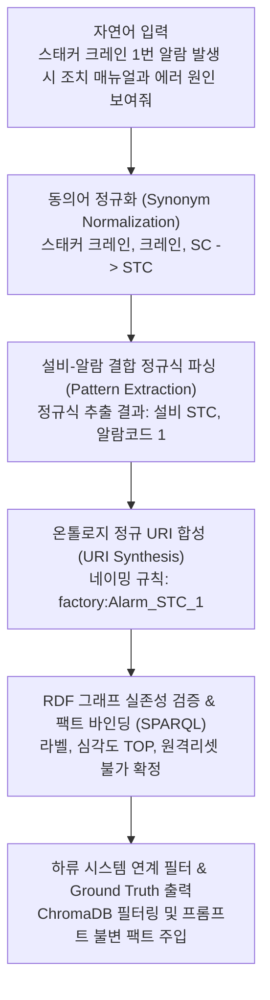

import { ArticleLayout } from '@/components/ArticleLayout'

export const article = {
  author: 'kkennib',
  date: '2026-10-13',
  title: '온톨로지 엔티티 매핑 및 SLM 연동 프로세스',
  description:
    '스마트 팩토리의 확률론적 언어 모델(SLM)에 결정론적 기호 논리를 접목한 여정. 왜 언어 모델에게 그래프 탐색을 직접 맡기지 않았는지, 그리고 엔티티 매핑을 통해 안전 가드레일을 구축한 하이브리드 아키텍처적 고찰.',
}

export const metadata = {
  title: article.title,
  description: article.description,
}

export default (props) => <ArticleLayout article={article} {...props} />

## 온톨로지 엔티티 매핑 및 SLM 연동 프로세스

거대한 물류 자동화 센터나 스마트 팩토리의 한가운데 서 있으면, 수천 개의 센서와 모터가 맞물려 돌아가는 소리 너머로 팽팽한 긴장감이 흐른다. 거대한 랙 사이를 분당 수백 미터의 속도로 활주하는 자동창고 스태커 크레인(Stacker Crane, 화물 적재용 고속 크레인)이나 갠트리 로봇(Gantry Robot, 직교좌표형 이송 로봇)의 궤적은 한 치의 오차도 허용하지 않는다. 이곳에서 설비 정지 알람이 울린다는 것은 단순한 소프트웨어 경고가 아니다. 단 몇 초의 판단 지연이나 잘못된 조치 하나가 수억 원의 다운타임(가동 중단 시간) 손실을 부르고, 작업자의 물리적 안전을 위협할 수 있는 비상사태다.

최근 생성형 인공지능과 경량 언어 모델(SLM, Small Language Model: 매개변수 규모를 10억-100억 개 내외로 압축하여 엣지 디바이스나 사내 온프레미스 서버에서 빠르게 구동 가능한 소형 인공지능)의 발전과 함께, 현장 작업자의 거친 구어체 질문을 AI가 알아듣고 즉각적인 조치 가이드를 제공하는 자율 관제 시스템에 대한 기대감이 높아지고 있다. "스태커 크레인 1번 알람 발생 시 조치 매뉴얼과 에러 원인 보여줘"라는 다급한 무전 한마디에 AI가 완벽한 해결책을 제시해 주는 시나리오다.

하지만 단순한 챗봇 프로토타입의 기대를 넘어 실제 공장 환경에 배포 가능한 견고한 아키텍처를 설계하려 했을 때, 시스템 설계팀은 거대한 공학적 벽에 부딪혔다. 거대 모델이든 경량 모델이든, 언어 모델의 본질은 결국 다음 단어를 예측하는 <strong>확률론적 생성기(Probabilistic Text Generator)</strong>에 불과하다는 점이었다. 그리고 0.1%의 확률적 환각(Hallucination, 사실과 다른 허위 정보를 그럴듯하게 날조하는 현상)조차 용납되지 않는 위험한 산업 현장에서, 이 확률의 바다에 기호 논리의 단단한 닻을 내리지 않는 한 AI는 결코 실제 현장에 발을 디딜 수 없었다.

---

## 언어 모델과 지식 그래프의 역할 분담과 설계 철학

지식 그래프(Ontology, 엔티티 간의 관계를 컴퓨터가 이해할 수 있는 정형화된 트리플 형태로 표현한 의미망)를 도입하겠다고 했을 때, 초기에 가장 흔히 제안받았던 아키텍처는 <strong>"SLM에게 직접 온톨로지 그래프를 탐색(Graph Traversal)하게 하거나 SPARQL 질의를 생성하게 하자(Text-to-SPARQL)"</strong>는 방식이었다. 언어 모델에게 풍부한 스키마 프롬프트를 쥐어주고 필요한 지식 트리플(주어-술어-목적어의 데이터 단위)을 스스로 찾아오게 만들면 가장 유연하지 않겠냐는 기대였다.

그러나 초기 테스트와 아키텍처 검증 과정에서 마주한 결과는 분명한 공학적 한계를 드러냈다.

1. <strong>SPARQL 문법 오류와 환각</strong>
   - 수십억 파라미터 규모의 SLM은 복잡한 온톨로지 네임스페이스와 SPARQL(지식 그래프 질의 언어) 조인 문법을 완벽히 소화하지 못함
   - 엉뚱한 속성명을 지어내거나 존재하지 않는 관계를 상상하여 쿼리가 실패하는 현상 빈발
2. <strong>지연 시간의 폭증</strong>
   - 모델이 그래프를 1개 홉(Hop, 관계를 거쳐 이웃 노드로 이동하는 탐색 단계)씩 탐색할 때마다 발생하는 다단 추론 호출은 수 초 이상의 레이턴시를 유발함
   - 알람이 울려 라인이 멈춘 긴박한 순간에 3-5초의 응답 지연은 현장 작업자의 신뢰를 저하시킴
3. <strong>치명적인 안전 가드레일 붕괴</strong>
   - 온톨로지에는 `isRemoteResettable = false`라는 절대적 공리가 정의되어 있음에도 불구하고, 언어 모델은 매뉴얼의 일반적인 문맥을 섞어 읽으며 "원격 제어반에서 리셋 버튼을 눌러보세요"라는 치명적인 오작동 지시를 생성함

SLM에게 그래프의 내비게이션 키를 넘겨주어서는 안 된다는 결론에 도달했다.

진정한 해결책은 기호주의(Symbolic AI, 규칙과 논리에 기반한 결정론적 지식 처리)와 연결주의(Connectionist AI, 신경망 기반의 확률적 패턴 인식)의 철저한 <strong>역할 분담과 경계 설정</strong>에 있었다. 파이썬 시맨틱 파서와 온톨로지 엔진이 <strong>2-5ms</strong> 만에 결정론적으로 엔티티를 매핑하고, 심각도와 표준 운영 절차(SOP), 원격 리셋 불가 여부, 벡터 데이터베이스의 검색 필터까지 완벽하게 세팅한다. 그리고 SLM에게는 이미 검증이 끝난 <strong>정답 울타리(Ground Truth)</strong> 안에서만 자연어 답변을 요약하고 설명하도록 제약을 가하는 것이다.

---

## 결정론적 엔티티 매핑 파이프라인

작업자의 거친 자연어 질의가 유입되었을 때, 시스템은 어떻게 확률의 불확실성을 걷어내고 온톨로지의 단 하나의 고유 노드로 직행하는가. 이를 위해 구축한 <strong>결정론적 엔티티 매핑(Entity Linking & Resolution) 파이프라인</strong>은 다음과 같다.



### 동의어 정규화(Synonym Normalization)

현장의 언어는 정제되어 있지 않다. 어떤 작업자는 "스태커 크레인"이라 부르고, 누군가는 "크레인", 현장 반장님은 "SC"나 "stc"라 부른다. 갠트리 로봇 역시 "갠트리", "주행로봇", "GTR" 등으로 난립한다. 

이 혼란을 잠재우기 위해 가장 먼저 통제된 어휘 사전(Controlled Vocabulary)을 거친다. 복잡한 임베딩 검색 대신 단순하고 명확한 해시 맵을 활용하여 $O(1)$의 속도로 표준 설비 코드로 수렴시킨다.

```python
EQUIPMENT_SYNONYMS = {
    "스태커 크레인": "STC", "스태커": "STC", "크레인": "STC", "sc": "STC", "stc": "STC",
    "갠트리 크레인": "GANTRY", "갠트리 로봇": "GANTRY", "갠트리": "GANTRY", "gtr": "GANTRY",
    "컨베이어": "CNV", "피딩 컨베이어": "CNV", "cnv": "CNV",
    "무인운반차": "RGV", "주행차": "RGV", "rgv": "RGV",
}
```

### 설비와 알람 식별자 분리 파싱

자연어 문장에서 가장 중요한 것은 <strong>설비 식별자(호기 번호)</strong>와 <strong>고장 식별자(알람 코드)</strong>를 서로 오염되지 않게 분리해 내는 일이다. 

`STC_01 고장`에서 `01`은 설비의 호기 번호이지만, `1번 알람`에서 `1`은 에러 코드다. 이를 언어 모델의 모호한 추론에 맡기지 않고 엄격한 정규 표현식으로 분리한다.

```python
pattern = r'(?:(cnv|stc|sc|rgv|gantry|gtr|컨베이어|크레인|갠트리)\s*[-_]?)?\s*([0-9]{1,4})\s*번?\s*(?:에러|알람|코드|고장)'
match = re.search(pattern, query, re.IGNORECASE)
if match:
    raw_eq = match.group(1)   # "스태커 크레인"
    raw_code = match.group(2) # "1"

    eq_type = EQUIPMENT_SYNONYMS.get(raw_eq, "STC") # "STC"
    alarm_code = str(int(raw_code))                 # "1"
```

### 온톨로지 정규 URI 합성

추출된 `STC`와 `1`은 사전에 정의된 온톨로지 T-Box(개념 및 클래스 체계) 스키마 규격에 따라 단 하나의 고유한 RDF 식별자로 합성된다.

- <strong>네임스페이스</strong>: `http://factory.ai/ontology#` (`factory:`)
- <strong>식별자 규칙</strong>: `Alarm_{EQUIPMENT}_{CODE}`
- <strong>합성된 URI</strong>: `factory:Alarm_STC_1`

이로써 모호한 자연어는 기호 세계의 고유한 식별 좌표로 탈바꿈한다.

### 그래프 실존성 검증과 속성 바인딩

합성된 URI가 실제 그래프에 존재하는지 A-Box(개별 인스턴스 데이터)를 대상으로 즉시 검증한다. RDFLib의 메모리 기반 인덱스를 통해 수 밀리초 만에 정답 노드를 특정하고, 핵심 속성을 바인딩한다.

```sparql
PREFIX factory: <http://factory.ai/ontology#>
PREFIX rdfs: <http://www.w3.org/2000/01/rdf-schema#>

SELECT ?label ?severity ?isReset ?sop WHERE {
    BIND(factory:Alarm_STC_1 AS ?alarm)
    ?alarm a factory:EquipmentAlarm ;
           rdfs:label ?label ;
           factory:hasAlarmSeverity ?severity ;
           factory:isRemoteResettable ?isReset .
    OPTIONAL { ?alarm factory:processMethod ?sop }
}
```

이 단계를 거치며 시스템은 타협할 수 없는 물리적 사실들을 확정한다.

- <strong>공식 명칭</strong>: `[STC] EMERGENCY STOP (GP) (Code: 1)`
- <strong>심각도</strong>: `TOP` (최상위 비상정지 고장)
- <strong>원격 리셋 가능 여부</strong>: `false` (원격 리셋 절대 불가)
- <strong>표준 조치 요약</strong>: `EMG(비상 정지) 버튼 누름, 리미트 스위치 접점 복귀 확인`

만약 누군가 실수로 `STC 9999번 알람`을 물어본다면 어떻게 될까. 그래프 조회가 `None`을 반환하는 순간 시스템은 즉각 "미등록 알람 코드"라는 안전 에러를 반환하며 후속 프로세스를 차단한다. 존재하지 않는 지식을 그럴듯하게 꾸며내는 생성형 AI의 고질적인 환각을 기호 단계에서 사전에 봉쇄하는 것이다.

### 하류 시스템 필터링과 기준 팩트 주입

온톨로지는 검색의 나침반이 되어 하류 시스템을 제어한다.

첫째, 대용량 비정형 매뉴얼을 보관하고 있는 <strong>벡터 데이터베이스(ChromaDB)</strong>에 하드 메타데이터 필터를 강제한다.

```json
{
  "$and": [
    {"equipment_primary": "STC"},
    {"error_code": {"$in": ["1", "0001"]}}
  ]
}
```

이 필터 설정을 통해, 단순 임베딩 유사도 검색 시 발생하기 쉬운 "컨베이어 1번 알람", "RGV 1번 알람" 같은 타 설비의 오검색 노이즈가 원천적으로 차단된다.

둘째, 추출된 심각도와 원격 리셋 불가 가드레일을 <strong>SLM의 시스템 프롬프트 최상단에 수정 불가능한 불변의 사실(Ground Truth)</strong>로 고정 주입한다.

---

## 기호 엔진과 언어 모델의 오케스트레이션

시스템의 전체 워크플로우를 조망해 보면, 기호 엔진과 언어 모델이 어떻게 각자의 장점만을 취하며 협업하는지 확인할 수 있다.


이 구조에서 두 주체의 책임은 명확하게 갈린다. 서로의 영역을 침범하지 않는 것, 이것이 아키텍처의 핵심 규율이다.

| 구분 | 온톨로지 지식 그래프 (`OntologyManager`) | SLM (`Small Language Model`) |
|:--- |:--- |:--- |
| <strong>본질적 역할</strong> | <strong>결정론적 팩트 보증 및 검색 나침반 (Ground Truth)</strong> | <strong>자연어 이해 및 문맥 종합 요약기 (Synthesizer)</strong> |
| <strong>수행 작업</strong> | • 질의 키워드로부터 `Alarm_STC_1` 노드 특정<br />• 심각도 `TOP`, 원격리셋 `불가` 판정<br />• ChromaDB용 하드 필터(`where`) 생성 | • 주입된 팩트와 매뉴얼 본문을 읽고 문맥 해석<br />• 작업자가 읽기 쉬운 단계별 조치 가이드 작성<br />• 현장 안전 주의사항을 강조한 문장 구성 |
| <strong>강점</strong> | 수학적 기호 논리, 환각 배제, $O(1)$ 속도 | 유연한 자연어 소통, 비정형 텍스트 요약 및 맥락 파악 |
| <strong>금지 사항</strong> | 수만 자의 긴 매뉴얼 본문 전체를 저장하지 않음 | 그래프 구조나 안전 수칙을 스스로 추측하지 않음 |

정제된 데이터는 최종적으로 다음과 같은 프롬프트 구조로 합성되어 SLM의 컨텍스트 윈도우에 입력된다.

```markdown
당신은 TITAN 스마트 팩토리 물류 관제 전문 AI 어시스턴트입니다.
아래 제공된 [온톨로지 확정 도메인 팩트]와 [관련 매뉴얼 발췌]만을 근거로 작업자의 질문에 정확하고 안전하게 답변하세요.

[온톨로지 확정 도메인 팩트 (Ground Truth - 수정 금지)]
- 설비 식별자: STC_01 (ASRS 1호 스태커 크레인, 1번 랙 라인 담당)
- 알람 코드: Alarm_STC_1 ([STC] EMERGENCY STOP (GP), 에러코드 1)
- 알람 심각도: TOP (최상위 비상정지 고장)
- 안전 가드레일: 원격 리셋 절대 불가(isRemoteResettable=false)
- 표준 조치 SOP: EMG 비상정지 버튼 해제 후 레일 리미트 접점 복귀 육안 확인

[관련 매뉴얼 및 기술 사양서 발췌 (Vector DB)]
문서: ERR_CODE 정리_V1.0_250311.xlsx | 분류: 에러 코드 | 섹션: STC 에러 코드
설비: STC (Stacker Crane) | 에러 코드: 1
에러명: EMERGENCY STOP (GP)
설명 및 조치방안: 현장 비상정지 스위치 눌림 상태 확인, 레일 이물질 유무 및 리미트 스위치 복귀 상태 점검 후 제어반 수동 조작
Reset 조치 가능 여부: 불가(X)
중요도: 상
---

[사용자 질문]
스태커 크레인 1번 알람 발생 시 조치 매뉴얼과 에러 원인 보여줘
```

SLM은 이제 모호한 추측의 늪에 빠지지 않는다. 프롬프트 상단에 고정된 Ground Truth라는 명확한 기준선 아래에서, 오직 매뉴얼 본문을 작업자가 읽기 쉬운 행동 지침으로 풀어내는 본연의 임무에만 집중하게 된다.

---

## 아키텍처 도입 성과와 엔지니어링 통찰

이 하이브리드 아키텍처를 통해 달성한 엔지니어링 성과는 다음과 같다.

1. <strong>환각 억제와 물리적 안전 보증</strong>
   - 온톨로지가 `isRemoteResettable = false`를 기호적으로 확정하여 주입하므로, SLM이 문장을 생성할 때 작업자에게 원격 리셋을 권유하는 치명적 오작동을 차단함
   - 안전은 모델의 확률이나 프롬프트 지침에만 의존하는 것이 아니라, 시스템 아키텍처 레벨에서 강제해야 함을 입증함
2. <strong>타 설비 노이즈의 원천 차단</strong>
   - 알람 코드 '1'이라는 흔한 숫자로 검색할 때 발생하던 컨베이어 1번, RGV 1번 등 타 설비 매뉴얼의 간섭을 온톨로지 하드 필터로 제거함
   - 검색 정밀도(Precision)와 응답의 정확성을 대폭 향상시킴
3. <strong>5ms 미만의 초저지연 달성</strong>
   - 복잡한 LLM 다단 추론 루프나 Text-to-SPARQL 대신, 파이썬 정규식과 RDFLib 인덱스를 결합하여 엔티티 매핑에 소요되는 시간을 5ms 이내로 단축함
   - 엣지 디바이스나 현장 관제 PC 환경에서도 경량으로 안정적으로 구동됨

---

## 결론 및 제언

생성형 AI 기술이 발전하면서 언어 모델 하나로 모든 문제를 해결할 수 있다는 기대가 커지고 있다. 그러나 실제 제조·물류 현장은 냉혹하다. 99번의 그럴듯한 답변보다 단 1번의 치명적인 환각이 생산 라인을 멈추고 안전사고를 유발하기 때문이다.

성공적인 산업용 AI 시스템의 본질은 언어 모델에게 무제한의 자율성을 부여하는 데 있지 않다. 기호 공학(Symbolic Engineering)의 단단한 레일을 설계하고, 그 통제된 궤도 위에서만 언어 모델이 지닌 유연함과 표현력을 발휘하도록 유도하는 절제의 미학에 있다.

확률론적 언어 모델에 결정론적 기호 논리의 닻을 내리는 일이야말로, 불확실한 AI 기술을 물리 현장의 실질적인 생산성과 안전으로 연결하는 엔지니어링의 정석이다.
